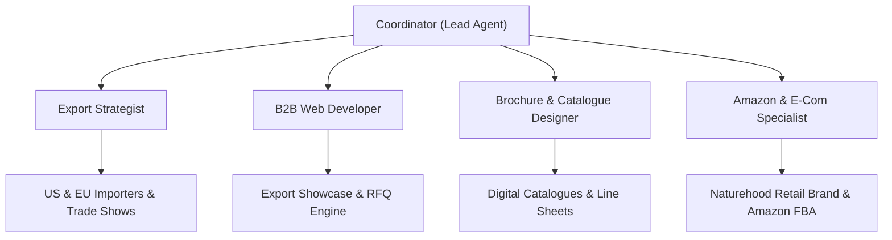

# Arawali Arts — Autonomous Agent Team Architecture & Operating Charter

## 1. Operating Rules & Boundaries
- **Strict Isolation**: Never push or index data from Arawali Arts into Cognee or Obsidian.
- **Independence**: This is an independent commercial venture separate from Endeavor Academy.
- **Repository**: All files, designs, catalogues, research, and scripts are stored in `/Users/endeavoracademy/OpenBot/Shared/Projects/ArawaliArts`.

---

## 2. Agent Roster & Operational Responsibilities

### Agent 1: `export-strategist`
* **Role**: International Market & Compliance Director
* **Mandate**:
  - Benchmark competitors (Bothra, Latiyal, Prince Art, Aztec Shiva, Lohiya).
  - Guide regulatory timber documentation: VRIKSH scheme, US Lacey Act declaration forms, EUDR geolocation proofs, and ISPM-15 fumigation standards.
  - Calculate container load plans (CBM optimization for 20ft/40ft HQ containers) and FOB Mundra price structures.
  - Formulate B2B buyer outreach plans for IHGF Delhi Fair, High Point Market, and Ambiente Frankfurt.

### Agent 2: `brochure-designer`
* **Role**: Digital Catalogue & Collateral Architect
* **Mandate**:
  - Maintain the export catalogue (`catalogue/arawali_arts_export_catalogue.html`).
  - Add new SKUs as photography arrives from the factory (Jodhpur workshop).
  - Output printable PDF-ready line sheets with master carton CBM, inner pack quantities, and FOB price columns.
  - Create themed lookbooks (e.g., "Nordic Jodhpur", "Architectural Jaali", "Artisanal Tabletop").

### Agent 3: `b2b-web-developer`
* **Role**: Digital Showroom & Inbound Lead Engineer
* **Mandate**:
  - Maintain and enhance the B2B exporter website (`website/index.html`).
  - Implement dynamic RFQ routing, sample order request workflows, and high-resolution zoomable galleries for wholesale clients.
  - Optimize mobile performance and international CDN delivery for US/EU buyers.

### Agent 4: `amazon-merchandiser`
* **Role**: E-Commerce & Retail Flywheel Lead
* **Mandate**:
  - Scale the *Naturehood* direct-to-consumer line on Amazon.
  - Optimize high-converting keywords (*handmade wooden book box*, *solid wood coaster set*, *iron jaali wall sconce*).
  - Draft A+ content, lifestyle infographics, and unboxing inserts that invite commercial/corporate gifting buyers to connect with Arawali Arts directly.

---

## 3. Workflow for Upcoming Factory Visit
As noted in the WhatsApp communication:
1. **Photo & Video Capture**: High-resolution photography of seasoning kilns, hand-turning lathes, iron welding/jaali forging, and raw wood stock.
2. **Asset Ingestion**: Place new photo assets directly into `/Users/endeavoracademy/OpenBot/Shared/Projects/ArawaliArts/assets/`.
3. **Agent Trigger**:
   - Run `brochure-designer` to add new product pages.
   - Run `b2b-web-developer` to refresh website collection grids.
   - Run `export-strategist` to generate targeted wholesale line sheets.
